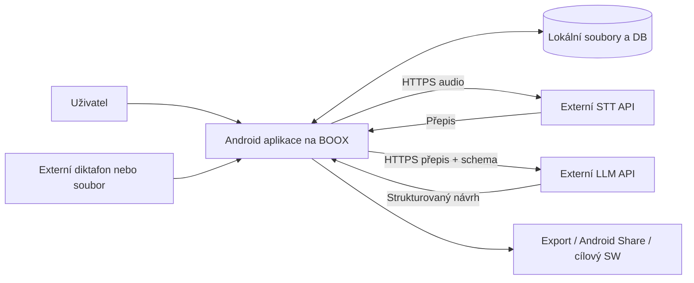

# BOOX Voice-to-Document — výchozí specifikace produktu a architektury

> **Typ:** živý projektový dokument (requirements baseline + solution outline)  
> **Verze:** 0.1 / draft  
> **Datum:** 2026-11-12  
> **Stav:** návrh k validaci, nikoliv schválená specifikace  
> **Cílové umístění v repozitáři:** `docs/PRODUCT_REQUIREMENTS_ARCHITECTURE.md`  
> **Jazyk specifikace:** čeština; identifikátory a technické názvy v angličtině

## 0. Pravidla interpretace

- **[POTVRZENO]** plyne z dosavadního zadání uživatele.
- **[NAVRŽENO]** doporučené řešení, nikoliv dosud schválený požadavek.
- **[OVĚŘIT]** technická, obchodní nebo právní hypotéza vyžadující důkaz/test.
- Priority: **MUST** = nutné pro danou verzi; **SHOULD** = preferované; **COULD** = volitelné; **WON'T (MVP)** = mimo první verzi.
- Značka **MVP** označuje první použitelnou verzi; **NEXT** možné další rozšíření. U položek [NAVRŽENO] je priorita rovněž návrhem.
- Kvalita či dostupnost externích modelů, ceny, jejich názvy a funkce BOOX se mohou měnit; před implementací se ověří aktuální dokumentace a reálné zařízení.

## 1. Kontext a cíl

### 1.1 Vize [POTVRZENO]

Na jednom zařízení s Androidem a E Ink displejem (primárně BOOX) má jeden uživatel pohodlně pořídit nebo importovat hlasový záznam, získat kvalitní český přepis, převést jej podle vybrané šablony na strukturovaný dokument, výsledek zkontrolovat, případně opravit a předat dále. Cílem je minimální počet ovládacích kroků a jednoduchost i pro technicky méně zkušeného uživatele.

Primární zařízení má zároveň plnit běžné funkce e‑knihy, předčítání knih a poznámkového bloku; tyto funkce však **nemají být znovu implementovány v naší aplikaci**, pokud je zajišťuje platforma nebo jiné aplikace.

### 1.2 Hranice systému

**V rozsahu vlastní aplikace:** záznam/import audia, správa záznamů, šablony, orchestrace STT a LLM, lokální kontrola a oprava, export/předání, konfigurace externích API, bezpečné ukládání rozpracované práce.

**Mimo rozsah vlastní aplikace (platformní schopnosti):** obecná čtečka e‑knih, TTS e‑knih, obecný univerzální zápisník BOOX a synchronizace těchto běžných zápisníků. Integrace ručních poznámek *do našeho workflow* je kandidátem NEXT, ne implicitním MVP požadavkem.

### 1.3 Zamýšlení uživatelé a provoz [POTVRZENO]

- Jediný uživatel v počáteční fázi.
- Lokálně instalovaná vlastní Android APK, bez povinného zveřejnění v Google Play.
- Nepravidelné, jednotlivé zpracování nahrávek; přesné objemy a délky nejsou dosud stanoveny.
- Zpracování prostřednictvím externích STT a LLM API, bez vlastní inference a bez vlastního backendu v MVP.
- Případné použití pro odborné/zdravotnické diktáty je **možné, nikoliv automaticky schválené pro práci s reálnými citlivými údaji**.

### 1.4 Kritéria úspěchu [NAVRŽENO]

1. Uživatel zvládne standardní cestu „nahrát/importovat → vybrat šablonu → zpracovat → zkontrolovat → exportovat“ bez technické asistence.
2. Žádný běžný výpadek sítě nesmaže původní nahrávku ani již potvrzenou editaci výsledku.
3. Výstup odpovídá vybrané šabloně a nejasné/chybějící údaje nejsou domýšleny.
4. Nahrávka, doslovný přepis a finální dokument lze při povoleném uchovávání dohledat společně.
5. Náklady na API a kvalita českého přepisu jsou před ostrým používáním ověřeny na reprezentativních nahrávkách.

## 2. Předpoklady, omezení a závislosti

| ID | Stav | Předpoklad / omezení | Důsledek nebo způsob ověření |
|---|---|---|---|
| ASM-001 | [POTVRZENO] | Pro MVP stačí jeden uživatel. | Bez multi-tenant architektury a centrálního účtu. |
| ASM-002 | [POTVRZENO] | Cílová platforma je Android na BOOX E Ink. | Nativní Android APK; design pro E Ink. |
| ASM-003 | [NAVRŽENO] | První testované zařízení je BOOX Go 10.3 Gen II Lumi. | Ověřit přesný model, verzi Androidu, mikrofon, RAM a chování firmware. |
| ASM-004 | [POTVRZENO] | STT a strukturování zajišťují vzdálená placená API. | Pro tyto kroky je nutné síťové spojení. |
| ASM-005 | [POTVRZENO] | MVP nemá vlastní serverovou vrstvu. | Volání API přímo ze zařízení; rizika klíčů přijata pouze pro prototyp/MVP. |
| ASM-006 | [NAVRŽENO] | Uživatel si vytvoří API účet, klíč zadá ručně. | Onboarding klíče, finanční limity a jeho revokace. |
| ASM-007 | [OVĚŘIT] | České STT a česká terminologie budou dostatečně přesné. | Srovnávací test na reálných, bezpečně získaných nahrávkách. |
| ASM-008 | [OVĚŘIT] | BOOX dovolí spolehlivý záznam s vypnutým displejem. | Test konkrétního firmware, oprávnění, služby na popředí a úsporných režimů. |
| ASM-009 | [OVĚŘIT] | Externí mikrofon/diktafon lze pohodlně připojit/importovat. | Kompatibilita BT/USB, tlačítka a formátů souborů. |
| ASM-010 | [OVĚŘIT] | Podmínky poskytovatele API připouštějí zamýšlený typ dat a lokalitu zpracování. | Právní/bezpečnostní posouzení před osobními/citlivými údaji. |
| ASM-011 | [NAVRŽENO] | Aplikace má být přenositelná i na běžný telefon Android. | Minimum závislostí na proprietárním BOOX SDK. |
| ASM-012 | [OVĚŘIT] | Existuje vhodná cílová cesta předání dokumentu. | Upřesnit soubor, schránku, sdílení, tisk či integraci cílového SW. |

## 3. Funkční požadavky

### 3.1 Pořízení a správa audia

| ID | Priorita | Stav | Požadavek / ověření |
|---|---|---|---|
| FR-AUD-001 | MUST / MVP | [POTVRZENO] | Uživatel může vytvořit nový zvukový záznam vestavěným mikrofonem. |
| FR-AUD-002 | MUST / MVP | [POTVRZENO] | Uživatel může importovat existující nahrávku z úložiště/externího diktafonu prostřednictvím systémového výběru souboru. |
| FR-AUD-003 | MUST / MVP | [NAVRŽENO] | UI jednoznačně ukazuje stav nahrávání, jeho trvání a umožní Start / Stop; nedovolí náhodné zahození bez potvrzení. |
| FR-AUD-004 | MUST / MVP | [NAVRŽENO] | Originální audio se uloží lokálně před odesláním do STT; chyba API jej nesmaže. |
| FR-AUD-005 | SHOULD / MVP | [NAVRŽENO] | Seznam nahrávek obsahuje datum, délku, stav zpracování a případně název. |
| FR-AUD-006 | SHOULD / MVP | [NAVRŽENO] | Uživatel si může záznam před odesláním přehrát. |
| FR-AUD-007 | SHOULD / MVP | [OVĚŘIT] | Záznam může pokračovat při zhasnutém displeji a po přechodu aplikace na pozadí. Nesmí se slíbit bez testu BOOX. |
| FR-AUD-008 | COULD / NEXT | [NAVRŽENO] | Podpora externího mikrofonu a externího tlačítka Start/Stop, pokud je daný hardware schopen předat potřebnou událost. |
| FR-AUD-009 | COULD / NEXT | [NAVRŽENO] | Několik epizod lze spojit do jednoho logického záznamu, při zachování hranic epizod a původních souborů. |
| FR-AUD-010 | COULD / NEXT | [NAVRŽENO] | Rozpoznání nadiktovaného názvu šablony z obsahu nahrávky; uživatel vždy může výsledek opravit. |

### 3.2 Šablony a zpracování

| ID | Priorita | Stav | Požadavek / ověření |
|---|---|---|---|
| FR-TPL-001 | MUST / MVP | [POTVRZENO] | Uživatel vybere cílovou šablonu strukturovaného dokumentu. |
| FR-TPL-002 | MUST / MVP | [NAVRŽENO] | Každá šablona obsahuje ID, verzi, popis polí, povinnost/volitelnost, instrukce ke zpracování a strojově validovatelné schéma výstupu. |
| FR-TPL-003 | MUST / MVP | [NAVRŽENO] | Před zpracováním lze zobrazit aktivní šablonu; výsledný dokument zaznamená její ID a verzi. |
| FR-STT-001 | MUST / MVP | [POTVRZENO] | Aplikace odešle audio externí STT službě a uloží doslovný český přepis. |
| FR-STT-002 | SHOULD / MVP | [NAVRŽENO] | Aplikace umožní předat STT jazyk a terminologické nápovědy, pokud je API podporuje. |
| FR-STT-003 | MUST / MVP | [NAVRŽENO] | Přepis je uživateli k dispozici samostatně a lze jej upravit před strukturováním i po něm. |
| FR-LLM-001 | MUST / MVP | [POTVRZENO] | Aplikace předá přepis a vybranou šablonu externímu LLM pro vytvoření strukturovaného dokumentu. |
| FR-LLM-002 | MUST / MVP | [NAVRŽENO] | LLM musí vrátit strojově zpracovatelný výstup podle JSON Schema nebo kompatibilního mechanismu. |
| FR-LLM-003 | MUST / MVP | [NAVRŽENO] | Aplikace lokálně validuje výsledek a chyby jasně signalizuje; chybné schema se nesmí tvářit jako úspěšné dokončení. |
| FR-LLM-004 | MUST / MVP | [NAVRŽENO] | Prompt výslovně zakazuje domýšlení faktů; neznámé hodnoty mají být vynechány/označeny podle schématu. |
| FR-LLM-005 | SHOULD / MVP | [NAVRŽENO] | Uživatel může opakovat jen STT nebo jen strukturování a použít dříve uložený přepis. |
| FR-LLM-006 | SHOULD / MVP | [NAVRŽENO] | Zvlášť se uvádějí upozornění na nejasnosti a chybějící povinné údaje. |
| FR-AI-001 | SHOULD / MVP | [NAVRŽENO] | Integrace STT a LLM používají zaměnitelná rozhraní providerů, nezávislá na UI a perzistenci. |
| FR-AI-002 | COULD / NEXT | [NAVRŽENO] | Podpora multimodálního přímého audio→struktura jako alternativní pipeline k dvoukrokovému STT→LLM. |

### 3.3 Kontrola, výstup a konfigurace

| ID | Priorita | Stav | Požadavek / ověření |
|---|---|---|---|
| FR-REV-001 | MUST / MVP | [POTVRZENO] | Uživatel může zkontrolovat a opravit výsledný strukturovaný dokument před předáním. |
| FR-REV-002 | MUST / MVP | [NAVRŽENO] | UI rozlišuje přepis od interpretovaného strukturovaného výsledku. |
| FR-REV-003 | MUST / MVP | [NAVRŽENO] | Po editaci uživatele aplikace neztratí změny při obnově UI, otočení displeje ani běžném ukončení aplikace. |
| FR-OUT-001 | MUST / MVP | [POTVRZENO] | Výsledek lze exportovat/předat mimo aplikaci. Konkrétní povinný formát a kanál jsou otevřené. |
| FR-OUT-002 | SHOULD / MVP | [NAVRŽENO] | MVP nabízí export jako prostý text a strukturovaný JSON, případně systémové Android Share. |
| FR-OUT-003 | COULD / NEXT | [NAVRŽENO] | DOCX/PDF či adaptér do konkrétního cílového informačního systému. |
| FR-CFG-001 | MUST / MVP | [NAVRŽENO] | Uživatel může zadat, ověřit, změnit a smazat API klíč bez jeho zobrazení v logu. |
| FR-CFG-002 | MUST / MVP | [NAVRŽENO] | Lze nastavit poskytovatele/model pro STT a LLM a zvolit výchozí šablonu. |
| FR-CFG-003 | SHOULD / MVP | [NAVRŽENO] | Aplikace informuje o chybě, limitu, nedostatku kreditu, absenci sítě a nabídne další bezpečný krok. |
| FR-DATA-001 | MUST / MVP | [NAVRŽENO] | Uživatel může mazat jednotlivé nahrávky, přepisy i výsledky; mazání vyžaduje potvrzení a respektuje závislosti. |
| FR-DATA-002 | SHOULD / MVP | [NAVRŽENO] | Retenční politika je konfigurovatelná; výchozí nastavení nebude nevratně mazat rozpracované úlohy. |
| FR-NOTE-001 | COULD / NEXT | [NAVRŽENO] | Ruční poznámky perem mohou být přiloženy k záznamu nebo dokumentu; převod rukopisu lze řešit systémovou službou/aplikací pouze po ověření rozhraní. |
| FR-SYNC-001 | WON'T (MVP) | [NAVRŽENO] | Vlastní obousměrná cloudová synchronizace projektových dat mezi zařízeními. Možný pozdější návrh; BOOX systémová synchronizace není automaticky integrací naší aplikace. |

## 4. Nefunkční požadavky

| ID | Priorita | Stav | Požadavek / měřitelná akceptace |
|---|---|---|---|
| NFR-UX-001 | MUST | [POTVRZENO] | Jednoduché UX pro méně technického uživatele; standardní workflow vedeno krokově bez znalosti pojmů STT/LLM. |
| NFR-UX-002 | MUST | [NAVRŽENO] | E Ink optimalizace: vysoký kontrast, velké ovládací prvky, minimum animací a rychlých překreslení; zkouška čitelnosti na zařízení. |
| NFR-UX-003 | SHOULD | [NAVRŽENO] | Přístupná česká lokalizace včetně chyb a potvrzovacích dialogů. |
| NFR-REL-001 | MUST | [NAVRŽENO] | Odeslání, timeout ani selhání AI volání nesmí smazat originální audio ani potvrzené uživatelské editace. |
| NFR-REL-002 | MUST | [NAVRŽENO] | Stav workflow se perzistuje; opakování po pádu zařízení vede k bezpečné obnově nebo k novému řízenému požadavku. |
| NFR-REL-003 | SHOULD | [NAVRŽENO] | Opakování síťových chyb s omezeným backoffem; ochrana před nechtěným vícenásobným placeným voláním. |
| NFR-PERF-001 | MUST | [OVĚŘIT] | Podporované maximální trvání/velikost nahrávky odpovídá limitům vybraného STT API a paměti zařízení. Konkrétní limit stanovit testem. |
| NFR-PERF-002 | SHOULD | [NAVRŽENO] | Aplikace zobrazuje stav zpracování a zůstává responzivní; síťové volání neblokuje UI vlákno. |
| NFR-SEC-001 | MUST | [NAVRŽENO] | Komunikace s API pouze přes HTTPS s validací certifikátu; žádné plaintext HTTP ani logování klíčů. |
| NFR-SEC-002 | MUST | [NAVRŽENO] | API klíče nejsou v APK, Git repozitáři, zálohách ani diagnostických exportech; jsou zadávány uživatelem a chráněny Android Keystore / vhodným šifrováním. |
| NFR-SEC-003 | MUST | [NAVRŽENO] | Před zpracováním osobních/zdravotních údajů se posoudí DPIA/role stran, právní základ, smlouvy, lokace, retence a přenosy dat; samotný HTTPS nestačí. |
| NFR-SEC-004 | SHOULD | [NAVRŽENO] | Lokální databáze a soubory jsou v soukromém úložišti aplikace; pro citlivá data volit ochranu v klidu a omezit systémové zálohy. |
| NFR-SEC-005 | SHOULD | [NAVRŽENO] | Omezení měsíční útraty/API rozpočtu na straně poskytovatele a upozornění při odhadované spotřebě. |
| NFR-MAINT-001 | MUST | [NAVRŽENO] | Oddělení UI, workflow, domény, úložiště a provider adapterů; modely a endpointy jsou konfigurovatelné. |
| NFR-MAINT-002 | SHOULD | [NAVRŽENO] | Verze šablon a schémat, reprodukovatelné migrace dat a testování na uložených anonymizovaných vzorcích. |
| NFR-OBS-001 | MUST | [NAVRŽENO] | Technická diagnostika pouze s časem, typem chyby, korelačním ID a anonymními metadaty; bez obsahu audia, transkriptu nebo dokumentu v běžných logách. |
| NFR-PORT-001 | SHOULD | [NAVRŽENO] | Funkčnost na standardním Androidu bez BOOX proprietárních API, kde to není nutné. |
| NFR-QUAL-001 | MUST | [NAVRŽENO] | Kvalita STT i extrakce polí musí projít věcným testem; JSON-validita sama o sobě nezaručuje správnost. |
| NFR-QUAL-002 | MUST | [NAVRŽENO] | Dokument je v UI výslovně označen jako návrh k lidské kontrole, nikoli automaticky autoritativní záznam. |

> **Poznámka k měřitelnosti:** cílové hodnoty přesnosti, latence, dostupnosti a podporovaných délek zatím nejsou známy. Nesmí být nahrazeny nezdůvodněnými SLA; stanovit po referenčním testování.

## 5. Use cases

### UC-01 — Pořídit a uložit hlasový záznam

- **Aktér:** uživatel.
- **Předpoklady:** aplikace má oprávnění mikrofonu a dostatek úložiště.
- **Spouštěč:** „Nová nahrávka“.
- **Hlavní tok:** (1) uživatel spustí nahrávání; (2) vidí indikaci běhu; (3) zastaví; (4) aplikace atomicky uloží soubor a metadata; (5) nabídne přehrání či zpracování.
- **Alternativy:** odmítnuté oprávnění; nedostatek místa; přerušení voláním; aplikace zabita OS; záznam při uspání nepodporován.
- **Postpodmínka:** korektní nahrávka je lokálně uložená, nebo je explicitně indikováno selhání bez falešného úspěchu.
- **Trasování:** FR-AUD-001/003/004/006/007, NFR-REL-001.

### UC-02 — Importovat externí nahrávku

- **Aktér:** uživatel.
- **Hlavní tok:** vybere „Importovat“ → systémový file picker → vybere kompatibilní audio → aplikace ověří čitelnost/formát → bezpečně zkopíruje či zpřístupní soubor → zobrazí jej v seznamu.
- **Alternativy:** nepodporovaný kodek, příliš velký soubor, zrušení výběru, ztráta oprávnění URI.
- **Postpodmínka:** import lze zpracovat bez trvalé závislosti na externím médiu.
- **Trasování:** FR-AUD-002/005, NFR-PERF-001.

### UC-03 — Převést nahrávku na český text

- **Aktér:** uživatel; **sekundární aktér:** STT provider.
- **Předpoklady:** audio, konektivita a platná konfigurace API.
- **Hlavní tok:** vybrat nahrávku → spustit přepis → zkontrolovat limity a stav sítě → odeslat STT → uložit odpověď a metadata modelu → zobrazit editovatelný přepis.
- **Alternativy:** 401/403, 429, limit velikosti, timeout, serverová chyba, prázdný či chybný přepis; opakovat bez ztráty audia.
- **Postpodmínka:** existuje verzovaný přepis nebo jasná chyba.
- **Trasování:** FR-STT-001/002/003, FR-CFG-001/003, NFR-REL-002.

### UC-04 — Strukturovat text podle šablony

- **Aktér:** uživatel; **sekundární aktér:** LLM provider.
- **Předpoklady:** přepis a vybraná šablona.
- **Hlavní tok:** zobrazit šablonu → potvrdit „Vytvořit dokument“ → odeslat přepis a schema/instrukce → přijmout strukturu → validovat schéma → zobrazit výsledek a nejasnosti.
- **Alternativy:** nevalidní JSON, odmítnutí modelem, chybějící povinné údaje, chybná interpretace, timeout.
- **Postpodmínka:** strukturovaný **návrh** s ID/verzí šablony nebo diagnostikovaný neúspěch.
- **Trasování:** FR-TPL-001/002/003, FR-LLM-001/002/003/004/006.

### UC-05 — Opravit a schválit návrh dokumentu

- **Aktér:** uživatel.
- **Hlavní tok:** zobrazit dokument → porovnat s přepisem (a podle potřeby audiem) → opravit pole → uložit → označit za připravené k exportu.
- **Alternativy:** vrátit se k přepisu; znovu spustit strukturování; přerušit editaci a později pokračovat.
- **Postpodmínka:** uložený uživatelsky zkontrolovaný dokument.
- **Trasování:** FR-REV-001/002/003, NFR-QUAL-002.

### UC-06 — Exportovat/předat dokument

- **Aktér:** uživatel.
- **Hlavní tok:** vybrat dokument → vybrat dostupný cílový formát/cestu → vygenerovat export → uložit nebo sdílet přes Android systém → potvrdit dokončení předání, pokud to kanál umožňuje.
- **Alternativy:** cílová aplikace není dostupná, nepodporovaný formát, uživatel zruší sdílení.
- **Postpodmínka:** dokument zůstává lokálně i při selhání exportu.
- **Trasování:** FR-OUT-001/002/003.

### UC-07 — Nastavit externí API

- **Aktér:** uživatel / správce jediného zařízení.
- **Hlavní tok:** vybrat providera → bezpečně vložit vlastní klíč → ověřit spojení bez úniku do logů → nastavit model a případný limit → uložit.
- **Alternativy:** neplatný klíč, nedostatečné kredity, nepodporovaný model, offline režim.
- **Postpodmínka:** použitelná konfigurace nebo srozumitelná diagnostika.
- **Trasování:** FR-CFG-001/002/003, NFR-SEC-001/002/005.

### UC-08 — Obnovit přerušené zpracování

- **Aktér:** uživatel; **spouštěč:** návrat aplikace po chybě, restartu či ztrátě konektivity.
- **Hlavní tok:** načíst perzistentní stav → zobrazit poslední úspěšný krok → umožnit pokračovat z uložených dat → před opakovaným placeným voláním upozornit na možnost dvojího účtování.
- **Postpodmínka:** uživatel nepřijde o dosud uložená data.
- **Trasování:** NFR-REL-001/002/003, FR-LLM-005.

### UC-09 — Vymazat vlastní data

- **Aktér:** uživatel.
- **Hlavní tok:** vybrat záznam → prohlédnout závislé artefakty → potvrdit odstranění → odstranit lokální data dle zvolené retence.
- **Alternativy:** neúspěšné odstranění některého souboru; informovat uživatele.
- **Postpodmínka:** lokální smazání je provedeno a diagnostikováno; **nelze tím automaticky zaručit odstranění dat u externího AI poskytovatele**.
- **Trasování:** FR-DATA-001/002, NFR-SEC-003.

### UC-10 — Zpracovat audio s nadiktovanou šablonou [NEXT]

- **Aktér:** uživatel.
- **Hlavní tok:** nahrát/importovat audio → rozpoznat formulaci typu dokumentu → navrhnout šablonu → uživatel ji potvrdí → pokračovat UC-03/04.
- **Riziko:** volně formulovaná instrukce z audia není důvěryhodná systémová instrukce; výběr musí být omezen na schválený katalog šablon.
- **Trasování:** FR-AUD-010.

## 6. Doménový a datový model [NAVRŽENO]

| Entita | Klíčové atributy | Poznámka |
|---|---|---|
| `Recording` | `id`, `createdAt`, `source`, `uri`, `duration`, `mimeType`, `size`, `status` | Originální audio, lokální URI. |
| `Transcript` | `id`, `recordingId`, `text`, `language`, `provider`, `model`, `createdAt`, `revision` | Oddělit surovou a editovanou revizi. |
| `DocumentTemplate` | `id`, `version`, `title`, `jsonSchema`, `instructions` | Verze je neměnná pro již zpracované dokumenty. |
| `StructuredDocument` | `id`, `transcriptId`, `templateId`, `templateVersion`, `data`, `validationIssues`, `reviewStatus`, `revision` | Návrh, revize, potvrzení. |
| `ProcessingJob` | `id`, `recordingId`, `step`, `status`, `attempt`, `provider`, `model`, `errorCode`, `startedAt`, `finishedAt` | Lokální evidence; nejde o serverovou frontu. |
| `ProviderConfiguration` | `providerId`, `modelId`, `secretReference`, `limits` | Samotný klíč mimo DB, v chráněném úložišti. |

Stavy doporučené workflow: `RECORDED → TRANSCRIBING → TRANSCRIBED → STRUCTURING → DRAFT_READY → REVIEWED → EXPORTED`, s odbočkami `FAILED_RETRYABLE`, `FAILED_FINAL`, `CANCELLED`. Zachovat historii pokusů, nevkládat API klíče do persistovaných requestů.

### 6.1 Příklad výstupního kontraktu (ilustrativní, ne doménová šablona)

```json
{
  "template_id": "example-note",
  "template_version": "1.0.0",
  "fields": {
    "subject": "",
    "summary": "",
    "recommendations": ""
  },
  "uncertainties": [
    {"field": "subject", "reason": "Údaj v diktátu nebyl uveden."}
  ]
}
```

Konkrétní typy dokumentů, pole, povinnosti, terminologie a pravidla validace se musí dodat jako samostatné verzované šablony. Výstupní kontrakt má odlišovat neuvedený údaj od prázdného, nečitelnému/nejistému a zápornému tvrzení; schema navrhnout dle této potřeby.

## 7. Architektura řešení

### 7.1 Kontextové schéma



### 7.2 Logické komponenty Android APK

1. **Presentation / E Ink UI:** jednoduchý průvodce, přehrání, editor a seznam úloh.
2. **Recording / Import:** Android audio API a Storage Access Framework.
3. **Workflow Coordinator:** lokálně perzistovaný postup, retry, idempotence tam, kde ji provider nabízí.
4. **Provider Adapters:** `SpeechToTextProvider` a `DocumentProcessor`, výběr modelu/endpointu.
5. **Template Engine + Validator:** lokální katalog verzovaných šablon, JSON Schema validace, mapování do UI.
6. **Local Persistence:** SQLite/Room + soukromé soubory a bezpečná evidence vazeb.
7. **Security & Settings:** správa klíčů, limity, síťová konfigurace, retenční pravidla.
8. **Export Adapter:** soubory, Share Intent a případné budoucí integrace.

**Kandidátní technologický stack [NAVRŽENO]:** Kotlin, Jetpack Compose nebo klasické Android Views (vyhodnotit chování na E Ink), Room, OkHttp/Retrofit, Kotlin coroutines, WorkManager pro obnovitelné odložené úlohy, Foreground Service pro podporované dlouhé nahrávání. WorkManager není automatickou zárukou neomezeného běhu při uspání; to vyžaduje test na BOOX.

### 7.3 Zpracovatelská pipeline

1. Uložit audio a metadata lokálně.
2. Ověřit velikost/formát/konfiguraci poskytovatele a souhlas s externím odesláním, je-li potřeba.
3. Zavolat STT API; uložit původní text a metadatovou stopu provider/model.
4. Umožnit editaci přepisu.
5. Na základě verze šablony sestavit instrukce, schema a strukturovací požadavek.
6. Zavolat LLM a lokálně validovat odpověď, oddělit validitu schématu od věcné kontroly.
7. Zobrazit návrh a nejistoty; zapsat úpravy uživatele.
8. Exportovat až po explicitní kontrole uživatelem.

### 7.4 Rozhraní poskytovatelů (koncept)

```kotlin
interface SpeechToTextProvider {
    suspend fun transcribe(recording: RecordingRef, options: SttOptions): TranscriptResult
}

interface DocumentProcessor {
    suspend fun structure(transcript: String, template: DocumentTemplate): StructuredResult
}
```

Provider adapter musí explicitně mapovat limity audia, podporované formáty, timeouty, stavové chyby, možnosti structured output a cenu/spotřebu; nekonfigurovat model pevně v doménové logice.

## 8. Architektonická rozhodnutí (ADR — návrhy)

### ADR-001 — Nativní Android aplikace
- **Stav:** proposed; **rozhodnutí:** Kotlin Android APK, prioritně BOOX, bez povinného BOOX SDK.
- **Důvod:** přístup k mikrofonu, souborům, lokálnímu stavu a perem ovládanému E Ink UI.
- **Alternativy:** web/PWA (horší řízení nahrávání a offline); multiplatform framework (pro MVP další vrstva).
- **Důsledek:** testovat Android lifecycle a firmware výrobce.

### ADR-002 — Bez vlastní serverové části v MVP
- **Stav:** accepted for MVP na základě zadání.
- **Rozhodnutí:** přímo z APK volat externí STT/LLM API.
- **Důvod:** jeden uživatel, rychlost vývoje a nulová vlastní serverová infrastruktura.
- **Riziko:** dlouhodobý API klíč v klientovi lze potenciálně získat; Android Keystore riziko snižuje, neodstraňuje.
- **Revisit trigger:** více uživatelů, produkční citlivá data, centrální nákladové limity nebo bezpečnostní požadavek.

### ADR-003 — Oddělené STT a LLM kroky
- **Stav:** proposed; **rozhodnutí:** audio→přepis→strukturování jako výchozí workflow.
- **Důvod:** auditovatelnost, možnost editovat přepis, izolované opakování a porovnání providerů.
- **Alternativa:** multimodální audio→struktura v jednom volání (experiment NEXT).

### ADR-004 — Vyměnitelní externí AI poskytovatelé
- **Stav:** proposed; **výchozí kandidáti:** OpenAI STT (v předchozím návrhu „gpt-transcribe“) a menší GPT model pro strukturování (v předchozím návrhu „gpt-5.4-mini“); Google Gemini jako alternativní experiment.
- **Poznámka:** konkrétní oficiální názvy modelů, API kompatibilitu, ceny, limity a dostupnost českého jazyka **ověřit při implementaci**, nejde o neměnné požadavky.
- **Důsledek:** provider-neutral rozhraní a verzování konfigurace modelu.

### ADR-005 — Lokální perzistence všech mezivýsledků
- **Stav:** proposed; **rozhodnutí:** původní audio, přepis, návrh a schválený výstup existují odděleně.
- **Důvod:** přerušení Wi-Fi, opravy, dohledatelnost a opakování jednotlivých kroků.
- **Důsledek:** retenční politika, šifrování a správa kapacity.

### ADR-006 — Schéma šablony je kontrakt
- **Stav:** proposed; **rozhodnutí:** verzované JSON Schema + instrukce + lokální validace.
- **Důvod:** konzistentní struktura a deterministické kontroly.
- **Omezení:** schema nepotvrzuje faktickou pravdivost; lidská kontrola je povinná.

### ADR-007 — Serverless proxy až při změně okolností
- **Stav:** deferred; **rozhodnutí:** pro MVP žádný kontejner ani VM.
- **Trigger:** požadavek na centrální autentizaci, ochranu API klíčů nebo správu více uživatelů.
- **Možnosti:** Azure Functions / Container Apps nebo Google Cloud Run; nevolit infrastrukturu před vznikem potřeby.

### ADR-008 — Synchronizace není součástí MVP aplikačních dat
- **Stav:** proposed; **rozhodnutí:** projektová data žijí lokálně, export je explicitní.
- **Důvod:** jednodušší bezpečnost, menší rozsah, žádná serverová úschovna.
- **Omezení:** synchronizace systémových poznámek BOOX s PC/mobily není automaticky řešena naším produktem.

## 9. Bezpečnost, soukromí a odpovědnost

- Nepoužívat sdílený tajný klíč zabalený v APK. Klíč zadává uživatel; Android Keystore chrání lokální uložení, nebrání všem formám extrakce na kompromitovaném zařízení.
- Založit samostatný API projekt s omezeným rozpočtem, průběžným monitoringem a možností okamžité revokace.
- Veškerá API komunikace HTTPS; citlivé vstupy/výstupy nesmí do běžného logování, crash reportingu ani analytiky.
- Systém nemá tvrdit, že výstup AI je automaticky správný; při odborné či zdravotnické dokumentaci je nezbytné uživatelské ověření a odpovědnost určené osoby.
- Externí poskytovatelé mohou data zpracovávat a dočasně uchovávat dle svých podmínek; „neukládáme na vlastní server“ **neznamená** nulovou retenci mimo zařízení.
- Před reálnými citlivými údaji prověřit smluvní podmínky, subprocesory, region zpracování, retenci, právní základ, transfery mimo EHP a bezpečnost koncového zařízení. Do té doby používat anonymizované či syntetické testovací nahrávky.
- Zvlášť rozhodnout o šifrování lokálních nahrávek, výchozí retenční době, zálohách a zabezpečení při ztrátě zařízení.

## 10. Verifikace a akceptační scénáře

| ID | Ověření | Očekávaný výsledek |
|---|---|---|
| AT-001 | Pořídit a uložit krátkou českou nahrávku na BOOX. | Lokální audio je přehratelné, správně identifikované. |
| AT-002 | Importovat soubor ze systémového file pickeru. | Po odebrání externího média lze import stále zpracovat. |
| AT-003 | Během STT ztratit Wi-Fi nebo restartovat aplikaci. | Audio zachováno; úloha bezpečně znovu spustitelná. |
| AT-004 | API vrátí 401, 429, 500 či timeout. | Srozumitelná chyba; nepřijde se o data ani uživatelské editace. |
| AT-005 | Strukturování vrátí JSON neodpovídající schématu. | Validátor jej odmítne a uživatel jej nedostane jako schválený dokument. |
| AT-006 | Diktát neobsahuje povinné pole. | Výsledek označí chybějící údaj a nevymyslí hodnotu. |
| AT-007 | Uživatel upraví přepis a znovu strukturuje. | Použije se nová revize přepisu; stará se neztratí bez rozhodnutí uživatele. |
| AT-008 | Uživatel upraví strukturovaný výstup a aplikace se restartuje. | Potvrzená editace se zachová. |
| AT-009 | Uživatel exportuje dokument. | Soubor/sdílený obsah odpovídá zobrazené schválené revizi. |
| AT-010 | Dlouhé nahrávání se zhasnutým displejem. | Změřit, zda konkrétní BOOX a firmware nahrávají bez výpadku; případně označit nepodporováno. |
| AT-011 | Test 10–20 českých reprezentativních diktátů. | Vyhodnotit věcnou přesnost STT, chyby terminologie, záměny negací/čísel a extrakci do polí. |
| AT-012 | Odhlášení / odebrání API klíče a kontrola logů. | Klíč není přístupný v běžných souborech, exportech, logách ani v binárce APK. |
| AT-013 | Test E Ink UX na zařízení. | Čitelné formuláře, nenápadné překreslení, ovladatelnost prstem i perem. |
| AT-014 | Zpracovat nahrávku bez internetu. | Nahrávka zůstane lokálně; uživatel dostane informaci o čekání na připojení. |

### 10.1 Způsob hodnocení kvality [NAVRŽENO]

Referenční sada českých nahrávek se souhlasem uživatele a bez osobních údajů v rané fázi. Ke každé: referenční přepis, očekávaná struktura, seznam kritických údajů (jména, jednotky, negace, dávkování, čísla). Vyhodnocovat zvlášť: (a) doslovný přepis, (b) správnost zařazení do polí, (c) nepodložená tvrzení, (d) počet nutných ručních oprav, (e) čas a cenu. Stanovit akceptační prahy až po pilotním měření.

## 11. Rizika a opatření

| ID | Riziko | Dopad | Mitigace |
|---|---|---|---|
| R-001 | API klíč unikne z Android klienta. | Neoprávněná útrata / přístup. | Vlastní klíč, Keystore, limity, revokace; při rozšíření proxy. |
| R-002 | STT přehlédne negaci nebo odborný výraz. | Věcně chybný dokument. | Ukázky testů, kontext, přístup k originálu, lidská kontrola. |
| R-003 | LLM doplní neexistující fakt. | Nepravdivý dokument. | Striktní instrukce, pole pro nejistoty, lidská revize. |
| R-004 | BOOX uspí nahrávání či síťový požadavek. | Neúplný záznam/zpracování. | Pilot na HW, foreground service, persistované workflow. |
| R-005 | Poskytovatel změní API/model/cenu. | Výpadek nebo vyšší náklady. | Adaptery, konfigurovatelné modely, monitoring spotřeby. |
| R-006 | Velký audio soubor přesáhne API limit. | Neúspěšné STT. | Předběžná validace, vhodný kodek, případné segmentování v NEXT. |
| R-007 | Nejasný cílový formát předání. | Aplikace nesplní praktický účel. | Vyjasnit cílovou aplikaci/export ještě před UI implementací. |
| R-008 | Retence osobních/zdravotních dat v AI API. | Právní a bezpečnostní riziko. | Ověření smluv a zpracování; nezpracovávat reálná citlivá data bez schválení. |
| R-009 | Příliš malé / pomalé E Ink UI. | Špatná použitelnost. | Prototyp na cílovém BOOX, omezení animací, úpravy interakcí. |

## 12. Otevřené otázky a rozhodovací backlog

| ID | Priorita pro upřesnění | Otázka |
|---|---|---|
| Q-001 | Před MVP | Jaké přesně typy strukturovaných dokumentů a jejich vzorové šablony požadujeme? |
| Q-002 | Před MVP | Jak má proběhnout předání: clipboard, TXT, JSON, DOCX, PDF, Android Share, konkrétní cílový systém? |
| Q-003 | Před MVP | Jaké jsou typické/maximální délky a velikosti nahrávek? |
| Q-004 | Před MVP | Je potřeba primárně přímé nahrávání, import z diktafonu, nebo obě varianty stejně? |
| Q-005 | Před pilotem | Potřebujeme spolehlivě nahrávat při zhasnutém displeji? Na jak dlouho? |
| Q-006 | Před pilotem | Konkrétní typ externího mikrofonu a chování jeho tlačítka? |
| Q-007 | Před pilotem | Který model BOOX a verzi firmware fyzicky testujeme? |
| Q-008 | Před MVP | Má výsledek obsahovat úplný přepis, nebo pouze strukturu, a jak řešit revize? |
| Q-009 | Před MVP | Jaká je požadovaná retence lokálních nahrávek a přepisů? |
| Q-010 | Před reálnými daty | Budou se v nahrávkách vyskytovat osobní či zdravotní údaje? Kdo je správcem údajů a jaké podmínky platí? |
| Q-011 | Před produkcí | Je přijatelná práce s API klíčem na jednom zařízení, nebo je nutná bezpečnostní proxy? |
| Q-012 | Po pilotu | Jaké přesně STT/LLM modely vítězí v kvalitě, latenci a ceně pro češtinu? |
| Q-013 | NEXT | Má aplikace umět spojit více epizod a identifikovat šablonu z hlasového povelu? |
| Q-014 | NEXT | Má aplikace přímo integrovat ruční poznámky/rozpoznávání rukopisu? |
| Q-015 | NEXT | Má existovat synchronizace dat aplikace mezi BOOX a telefonem/PC, nebo stačí export? |

## 13. Navržené pořadí implementace

1. **Spike A — zařízení:** instalace APK, mikrofon, audio formáty, záznam při uspání, import souborů, E Ink ovládání.
2. **Spike B — AI kvalita:** identická česká testovací nahrávka přes vybrané STT providery a šablony; kvalitativní a cenové vyhodnocení.
3. **MVP 1 — happy path:** Record/Import → STT → editace přepisu → LLM JSON → validace → editace → TXT/JSON export.
4. **MVP 2 — robustnost:** perzistentní stavy, opakování kroků, práce bez Wi-Fi, správa klíčů a smazání dat.
5. **Pilot s uživatelem:** měřit počet dotyků, úspěšnost, opravy, E Ink odezvu a náklady.
6. **NEXT podle zpětné vazby:** externí tlačítko/mikrofon, spojování epizod, hlasový výběr šablony, DOCX/PDF, zápisky perem, synchronizace.

## 14. Konvence další práce v repozitáři

- Po schválení rozdělit tento soubor na `docs/requirements.md`, `docs/architecture.md`, `docs/use-cases.md`, `docs/adrs/`, `docs/templates/` a testy; **do té doby je tento dokument single source of truth**.
- Každý nový požadavek musí mít unikátní ID, stav, prioritu a odkaz na use case / akceptační test.
- ADR mají stav `proposed | accepted | superseded | rejected`, důvod, alternativy a dopady.
- Neodstraňovat historické identifikátory; zrušené položky označit jako `deprecated`.
- Veškeré testovací nahrávky v repozitáři musí být umělé nebo řádně anonymizované a právně použitelné. Reálné klíče, audio ani identifikovatelné přepisy do Git nikdy necommitovat.
- `README.md` může na tento dokument pouze odkazovat; dokument zatím nesupluje implementační backlog, API kontrakty ani právní posouzení.

---

**Výslovně nepotvrzené oblasti:** přesné šablony, cílové exporty, maximální délky, ovládání externím mikrofonem, záznam při zhasnutém displeji, podpora češtiny konkrétními modely, zpracování skutečně citlivých dat a finální akceptační metriky. Považovat je za otevřené otázky, ne za slíbené schopnosti.
